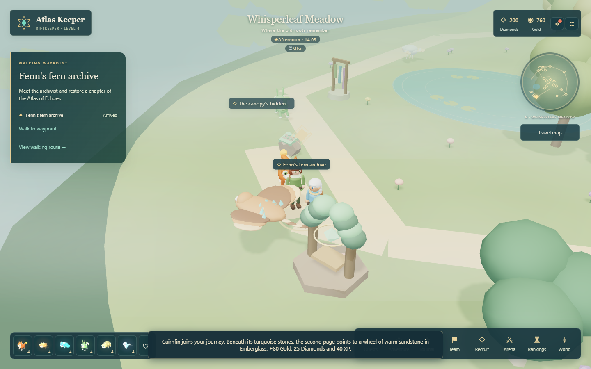
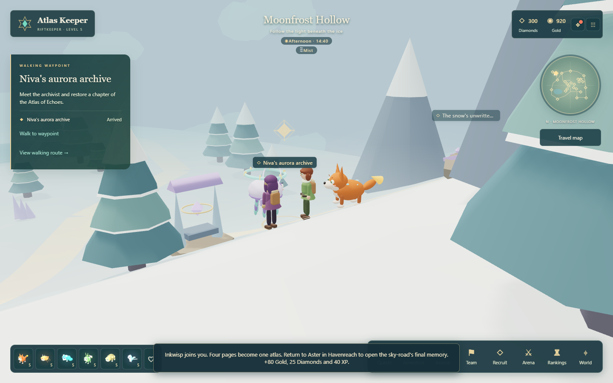

# The Atlas of Echoes

Four scattered memories tell the story of a sky-road built from acts of kindness. Meet four archivists, read their inscriptions, arrange each memory's glyphs and carry the completed atlas home.

Open **Adventure > The Atlas of Echoes / A journey through four memories**, Events, or the pause menu. On the **Travel map**, choose an archive or inscription, select **Set walking waypoint**, then **Walk to waypoint**.

## Begin with Aster

Form your six-companion team with Warden Liora, then visit **Aster's map pavilion** in Havenreach. Choose **Begin the atlas journey**. The regional restoration quests, Conservancy and Wayfarer Rally are optional; none is required to begin this story.

Chapters restore in order. Whisperleaf is open immediately, Emberglass requires two battle wins, and Moonfrost requires five. The journal explains these gates when a later chapter is locked.

| Chapter | Archivist and place | Inscription |
| --- | --- | --- |
| A map that remembers | Aster's map pavilion, Havenreach | The river's first page |
| The weight of kindness | Fenn's fern archive, Whisperleaf Meadow | The canopy's hidden page |
| What the storm left behind | Suri's sandstone orrery, Emberglass Canyon | The kiln's sheltered page |
| A light carried home | Niva's aurora archive, Moonfrost Hollow | The snow's unwritten page |

## Read, remember, restore

Walk to the chapter's inscription and select **Record this memory**. The text stays in your journal after you leave. Return to its archivist and arrange three glyphs in the order described by the memory. Each glyph is labeled **Seed**, **River**, **Sun** or **Star**; no sound, color matching or time limit is required.

Use **Read a hint** if needed. Wrong answers cost nothing and leave your progress intact. Selecting a journal tab lets you revisit a recorded chapter or track its places. Restoration requires standing near the archivist.

Each restored chapter grants **80 Gold, 25 Diamonds and 40 XP**, once. Its monument gains a floating memory light and a resident companion. Fenn's chapter also awards **Cairnfin**; Niva's awards **Inkwisp**. If you already own either, normal duplicate-shard rules apply.

After all four chapters, return to Aster and select **Complete the Atlas of Echoes** for **80 Diamonds, 80 XP and the Lorekeeper badge**. Normal level-up rewards can add Diamonds alongside activity rewards.

## Daily echo readings

Finishing the atlas unlocks one reading at each regional archivist per UTC day. Identify the requested position in that region's remembered glyph sequence; the saved inscription remains available above the question.

A correct reading grants **20 Gold and 10 XP**. Incorrect answers cost nothing. Readings reset at **00:00 UTC**; story progress and rewards never reset. There is no streak or missed-day penalty.

## Restored places

## Two new Wildbound

**Cairnfin** is a B-tier Stone tank: a floating sandstone ray with layered ochre fins, turquoise geodes and a copper ribbon tail. **Cairn Shelter** grants guard and shields to allies. Its skill effect surrounds the battlefield with stone fragments and turquoise rings.

**Inkwisp** is an A-tier Shadow support spirit: a pearl-violet bell with six teal tentacles and a halo of golden runes. **Memory Wash** cleanses allies and grants shields and haste. Its effects use floating runes and curling memory trails.

Both join normal recruitment pools. Tier odds are unchanged; the B and A species pools each gain one member. Normal and shimmering appearances, training, equipment and friendship use the existing systems.

## Saved progress

Discovered inscriptions, restored chapters, the finale and daily readings are saved on the server. Chapter order, region, answers and duplicate rewards are validated. Distance is checked by the client, as in the existing exploration activities.

This story adds eight destinations and approach paths within the current four region boundaries. Archivists reuse existing keeper bodies; archives are outdoor landmarks without interiors. See [PROGRESS.md](../PROGRESS.md) for current verification and [KNOWN_ISSUES.md](../KNOWN_ISSUES.md) for remaining limits.
