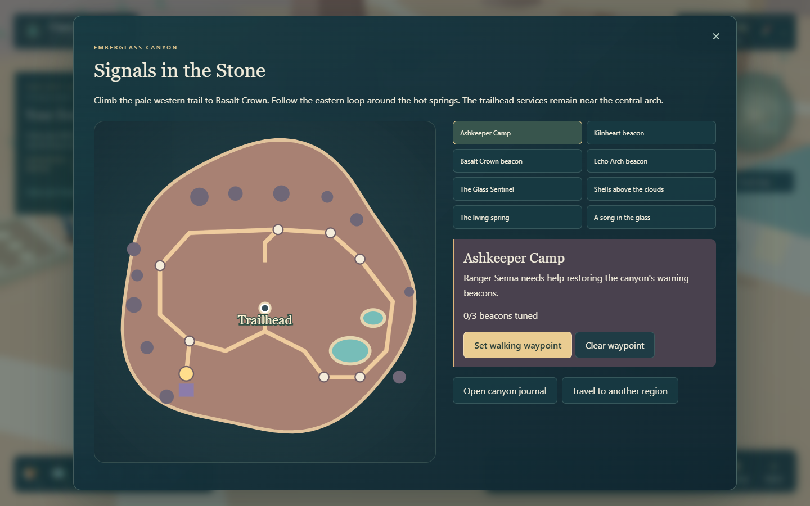
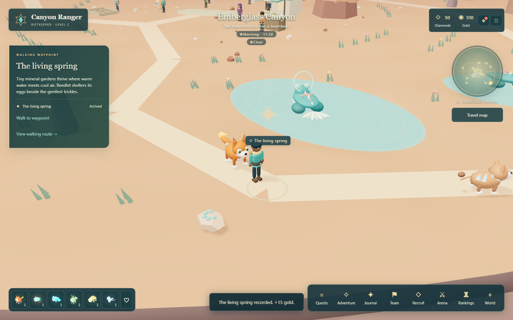

# Exploring Emberglass Canyon

Win two encounters to unlock Emberglass, then choose **Travel map > Travel to another region > Emberglass Canyon**. Open **Adventure > Signals in the Stone** to read the new journey. The journal is also available from the pause menu.



## Signals in the Stone

1. Choose **Ashkeeper Camp** on the canyon map, set a walking waypoint, and select **Walk to waypoint**. Ranger Senna's shelter sits above the western trail. Begin the canyon journey there.
2. Visit the three beacons. Choose any owned companion of the required element, read the inscription, and set the three shutters from left to right. The colors are written out for accessibility. A wrong pattern costs nothing; companions do not need to be in the active team.
3. With all signals tuned, visit **The Glass Sentinel** at the northern arch. Its three-round cycle is announced before acting: protective carapace, stronger heat surge, then vulnerable cooling fractures. Build energy, shield or heal during the surge, and attack during the cooling phase.
4. Return to Senna and restore the canyon signals. Your beacons stay lit, a signal halo appears above the camp, and Thermala joins your collection. Already owning Thermala grants a shard instead.

| Beacon | Companion | Ability |
| --- | --- | --- |
| Kilnheart | Flame | Kindle |
| Basalt Crown | Stone | Brace |
| Echo Arch | Storm | Resonate |

The companions received from Liora provide all three elements, regardless of your starter. Every tuned beacon grants 40 Gold and up to 5 friendship. First sentinel victory grants 90 Gold and 100 XP. Restoration grants 220 Gold, 60 Diamonds and Thermala. These rewards cannot be repeated by reloading or replaying requests. A lost battle can be retried.

## Field notes and habitats

Record **Shells above the clouds**, **The living spring**, and **A song in the glass** at their marked sites. Each grants 15 Gold once. Bring all three notes to camp to claim 35 Diamonds and the **Canyon Naturalist** badge, displayed beside your name while exploring Emberglass.

Cindervane mantises roam the western terraces. Thermala salamanders live in the hot springs, and Coppershell, Zippinch, Magmole, Cragpup and Flintuff inhabit the trails. Click a resident to observe its species card. These are ambient habitats; the central wild-encounter service still starts ordinary battles.



## Routes and comfort

The western loop climbs gently through basalt columns to the camp and crown beacon. The eastern loop passes around two mineral pools. Water and solid scenery block movement, and the trail map uses the same coordinates as the world. Setting a waypoint makes its distance visible; **Walk to waypoint** follows the route. Steering with the keyboard cancels automatic walking.

The pause menu offers **Return to canyon trailhead** and **Reset exploration camera**. Reduced motion stops decorative steam drift and reduces creature motion. Low graphics reduces steam particles and wildlife visibility distance. These options reduce rendering work; they are not a universal performance guarantee.

## Verification

```powershell
npx vitest run tests/canyon.test.ts tests/canyon-server.test.ts tests/models.test.ts
npx playwright test tests/browser/canyon.spec.ts tests/browser/gallery.spec.ts --grep canyon
```

See [PROGRESS.md](../PROGRESS.md) for the final verified results and remaining limits.
