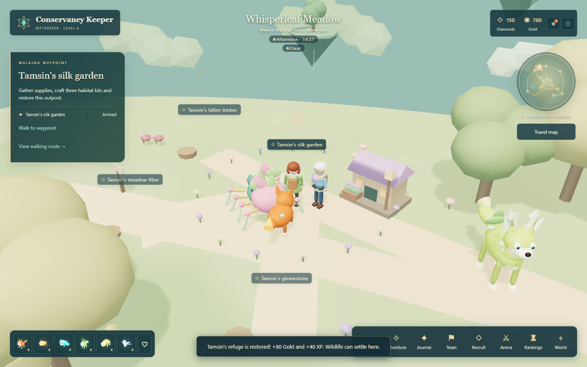
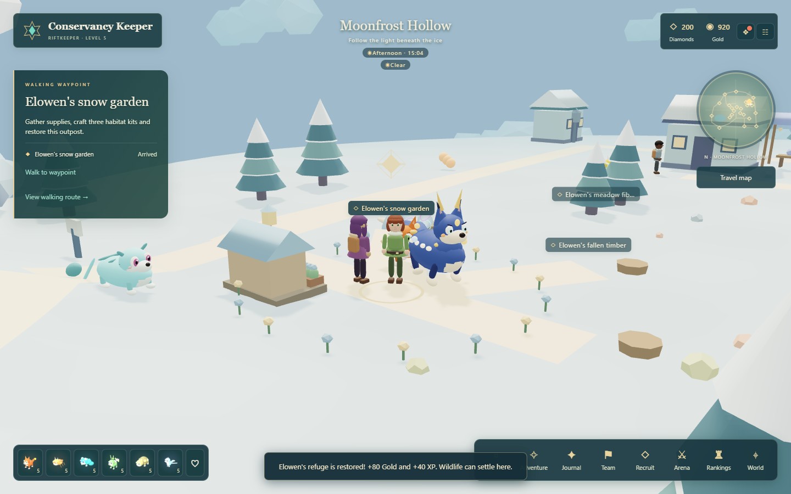

# Wildhaven Conservancy

Build a welcome and let the wild return. Restore four small refuges by gathering fallen supplies, crafting habitat kits and installing them. Your work becomes visible in the world: a shelter, planter and lantern appear, followed by flowers and a resident companion.

Open **Adventure > Wildhaven Conservancy / Craft and restore habitats**, **Events**, or the pause menu. Every steward and supply site also appears on the regional **Travel map**. Select a destination, choose **Set walking waypoint**, then **Walk to waypoint**.

Form your initial six with Warden Liora first. Whisperleaf is open immediately; Emberglass needs two wins and Moonfrost needs five. The Conservancy does not require finishing the regional restoration quests or Wayfarer passport.

## Four refuges

| Region | Steward and refuge | Returning wildlife |
| --- | --- | --- |
| Havenreach | Juniper's orchard refuge, south of the orchard | Mossloom |
| Whisperleaf Meadow | Tamsin's silk garden, near the northern heartroot trail | Mossloom |
| Emberglass Canyon | Daro's cliff sanctuary, on the western terrace | Astralynx |
| Moonfrost Hollow | Elowen's snow garden, north of the trailhead | Astralynx |

Each steward has a short story under **Talk with**. Their outpost is a workshop for crafting and dismantling. Supply sites branch off the approach trails; the inventory travels with you between regions.

## Gather and craft

Each region has one site for **Fallen timber**, **Meadow fiber** and **Gleamstone**. A site grants three units once per UTC day. Empty baskets show what you have collected. Sites replenish at **00:00 UTC**; materials and kits never expire.

| Blueprint | Ingredients | Purpose |
| --- | --- | --- |
| Shelter kit | 2 Fallen timber + 1 Meadow fiber | Dry nesting shelter |
| Planter kit | 2 Meadow fiber + 1 Gleamstone | Seed garden and bedding |
| Trail lantern | 2 Gleamstone + 1 Fallen timber | A guide light for travelers |

Gathering all three sites in a region provides exactly enough materials to craft one of each kit. Stand near any steward to use the **Habitat workshop**. You can bring materials and kits from other regions.

**Dismantle** any spare kit to receive all its ingredients back. It costs no currency. Installed pieces are permanent and cannot be dismantled. Bags hold up to 999 of each material and 99 of each kit; the server rejects actions that would exceed those limits.

## Restore and return

At a refuge, install one of each kit. Its appearance changes after every installation. Completing all three grants **80 Gold and 40 XP**, once per region, and brings wildlife and flowers to the site.

Return to **Juniper in Havenreach** for milestone awards:

- **Two restored refuges:** Mossloom, 80 Diamonds and 50 XP.
- **Four restored refuges:** Astralynx, 150 Diamonds and 50 XP, plus the Conservator HUD badge.

Each award is claimable once. If you already own its species, you receive a duplicate shard instead. Normal level-up rewards may add Diamonds alongside the listed activity rewards.

After restoration, **Tend habitat** uses one spare Planter kit for **25 Gold and 15 XP**, once per region per UTC day. Your first gathered set covers restoration, so you may need a later day's supplies for extra care. There is no streak or missed-day penalty.

## Restored landscapes

## New companions

**Mossloom** is an A-tier Grove support spider with eight jointed amber legs, a rose silk abdomen and a leaf crown. **Silken Sanctuary** shields allies, cleanses ailments and grants regeneration. Its effects combine woven rings and soft petals.

**Astralynx** is an S-tier Light striker with midnight-blue fur, pearl spots, golden ear tufts and three aurora tails. **Constellation Pounce** deals piercing damage and marks an enemy row. Its effects combine star motes and curved light trails.

Both also join their normal recruitment tiers. Tier probabilities are unchanged; the A and S species pools are each one larger. Training, equipment, friendship, duplicate shards and persistent shimmer appearance follow the existing rules.

## Saved progress and verification

The server saves materials, spare kits, installed pieces, daily collections, daily care and milestone claims. Reloading preserves them. Invalid recipes, wrong-region sites, stale days, insufficient inventory and duplicate rewards are rejected. Client-side distance checks require you to walk to an interaction point.

See [PROGRESS.md](../PROGRESS.md) for completed checks and [KNOWN_ISSUES.md](../KNOWN_ISSUES.md) for remaining limits. This is a local exploration and crafting activity, not a shared multiplayer construction system.
