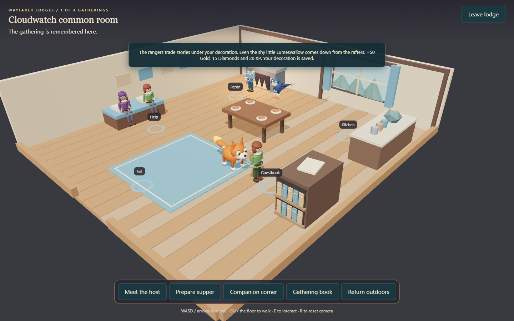
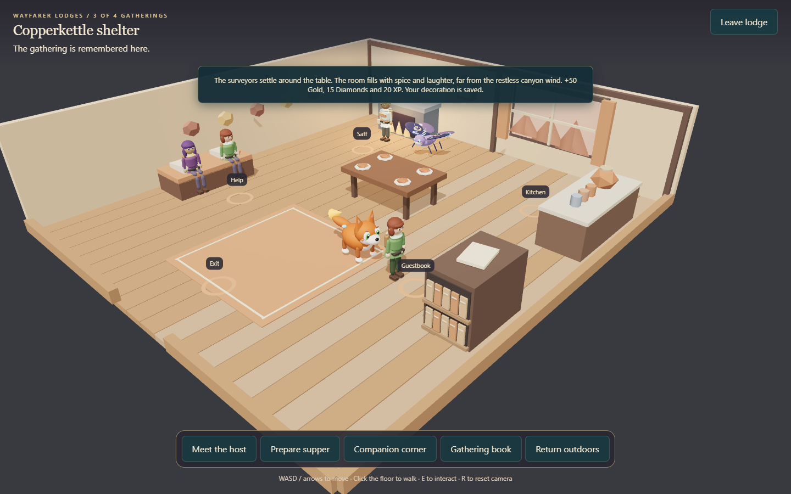
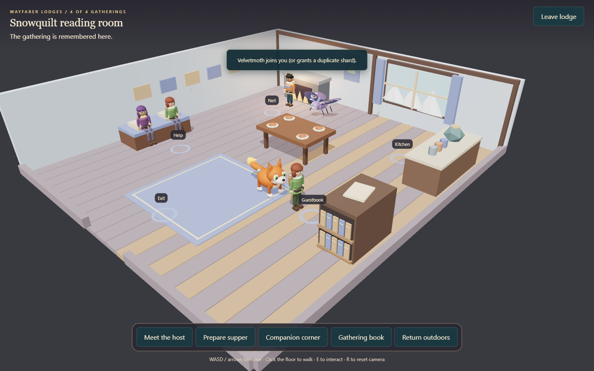
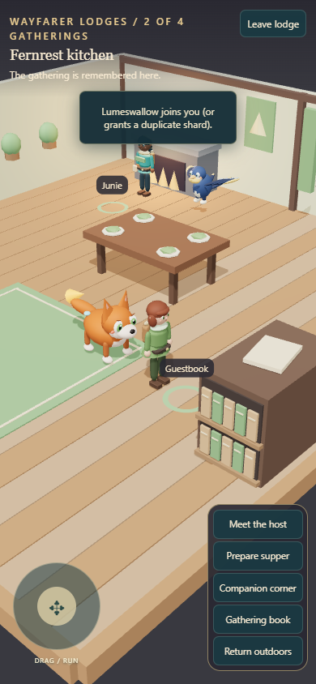

# Wayfarer Lodges

Four rooms now open from existing buildings. Use **Adventure > Wayfarer Lodges / Step inside and host a gathering**, or select a lodge on the regional travel map. Set its walking waypoint and follow it to enter.

| Region | Room and host | Supper | Companion ability |
| --- | --- | --- | --- |
| Havenreach | Cloudwatch common room / Perrin | Cloudberry tea | Beacon: Flame or Light |
| Whisperleaf | Fernrest kitchen / Junie | Dewleaf broth | Nurture: Tide or Grove |
| Emberglass | Copperkettle shelter / Saff | Sunroot stew | Brace: Stone or Frost |
| Moonfrost | Snowquilt reading room / Nell | Moonmint cocoa | Scout: Storm or Shadow |

Emberglass requires two battle wins; Moonfrost requires five. Every starter team has the needed abilities after meeting Liora. Bring the right companion in your active formation before entering.

## Inside a lodge

Walk with WASD or arrows, click the floor, or choose a station from the room navigation. On touch screens, use the joystick or station buttons. Furniture blocks movement; station buttons find a route around it. Press R to reset the camera. E walks to and opens the nearest station. Escape closes the current conversation. **Leave lodge** returns immediately to the doorstep; **Return outdoors** walks to the exit first.

1. Meet the host and offer to help.
2. Visit the kitchen. Read the recipe note and choose its ingredients. Hosts supply everything; incorrect choices consume nothing.
3. Visit the companion corner. Choose an active companion with the requested ability. Its contribution is saved, and it gains three friendship, capped at 100.
4. Visit the gathering book. Hang a lantern or weave a banner, permanently decorating this room and welcoming two guests. Each gathering grants 50 Gold, 15 Diamonds and 20 keeper XP once.

Supper and companion help can be completed in either order. Completed rooms remain open for visits. Bowls appear on the table after cooking; each region has its own wall details and window view. The lodge resident and host stay animated while exploring. Residents stroll around furniture and pause along the way. Reduced Motion stops their roaming and softens idle animation.

## Workshops and returning visits

After hosting a gathering, choose **Host & workshop** to build that room's permanent display. Use materials gathered at the existing Conservancy supply sites on regional maps; those sites replenish at 00:00 UTC. The workshop shows your current stock and the exact cost before you build.

| Lodge | Display | Materials consumed once |
| --- | --- | --- |
| Cloudwatch | Skychart stand | 2 Fallen timber, 1 Meadow fiber |
| Fernrest | Seedling cradle | 1 Fallen timber, 2 Meadow fiber |
| Copperkettle | Fossil cabinet | 2 Fallen timber, 1 Gleamstone |
| Snowquilt | Constellation mobile | 1 Meadow fiber, 2 Gleamstone |

Each display unlocks three stories from its host. Use the numbered story buttons to read them at your own pace. These stories remain available whenever you return; your current reading selection resets when you close the conversation. The Adventure journal tracks all four displays and their material requirements.

The gathering book also lets you switch freely between a lantern and banner after the first gathering. Switching does not spend supplies, repeat gathering rewards, or remove your crafted display. Workshops add furnishings and stories without granting more currency or combat bonuses.

Each room has its own furniture arrangement. Cloudwatch has a compass-pattern rug; Fernrest has an offset supper table and leaf motifs; Copperkettle has tiled flooring and a relocated guestbook; Snowquilt has a rear dining table and a quilt-pattern reading nook. Navigation and resident routes follow each room's furniture layout.

## New companions

Host any two gatherings to welcome **Lumeswallow**, a B-tier Light support with midnight plumage, luminous feather tips and a forked tail. **Hearthflight** shields allies and grants regeneration.

Host all four to welcome **Velvetmoth**, an A-tier Frost controller with broad eyespot wings and feathery antennae. **Quietfall** damages, slows and silences the selected enemy row.

| Lumeswallow | Velvetmoth |
| --- | --- |
|  |  |

Claim either companion once from any lodge's gathering book. Existing ownership grants a duplicate shard; new ownership uses the usual persistent 1-in-50 shimmer roll. Both species also join their existing recruitment tiers; tier probabilities are unchanged.

## Save behavior and scope

Host introductions, recipes, helper identities/species, decorations, workshop displays, spent supplies and companion claims are saved by the server. Replayed requests cannot grant repeated rewards. Legacy saves initialize lodge progress only when needed. The precise indoor position is temporary: reloading starts outdoors in the saved region, with room progress preserved.

The four rooms use distinct furniture layouts inside the same outer room dimensions. They are personal scenes with finite authored gatherings, not shared multiplayer interiors or daily currency farms. Outdoor region boundaries are unchanged. Proximity and movement remain client-enforced, consistent with other exploration activities; the server checks mainland region, ownership, abilities, prerequisites and rewards.

## Regional views

The room navigation becomes a vertical set of buttons beside the movement joystick on a narrow screen:

