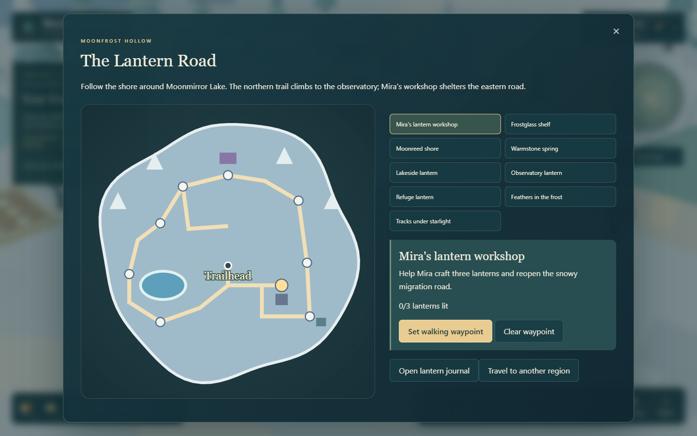
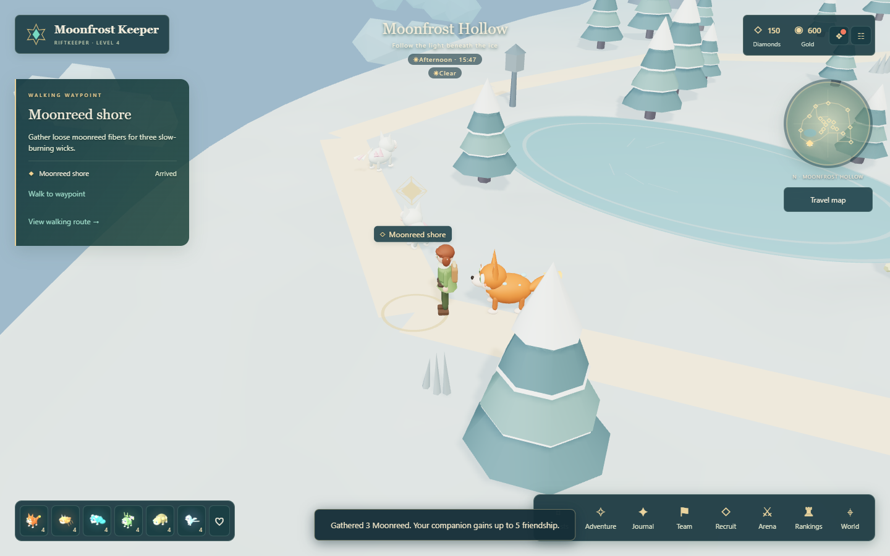

# Exploring Moonfrost Hollow

Win five encounters to unlock Moonfrost, then choose **Travel map > Travel to another region > Moonfrost Hollow**. **Adventure > The Lantern Road** opens the full journal; the pause menu has the same journal.



## The Lantern Road

1. On the regional map, select **Mira's lantern workshop**, set a waypoint, and choose **Walk to waypoint**. Begin the journey with Mira.
2. Visit the three gathering sites. Choose an owned companion of the required element. Your starting team provides all three elements. Companions gain up to five friendship when helping.
3. Return to the workshop and craft three trail lanterns. Each costs **2 Frostglass, 1 Moonreed and 1 Warmstone**, with no Gold cost. Your satchel shows remaining materials and carried lanterns. Every gathering site is collected once; together they provide exactly enough for the journey.
4. Carry one lantern to each of the **Lakeside**, **Observatory**, and **Refuge** posts. Every installation grants 25 Gold and visibly lights that post.
5. Return to Mira to restore the road. Receive Rimeowl (or a duplicate shard), 200 Gold, 70 Diamonds, 120 XP and the **Lantern Keeper** badge. The observatory aurora becomes brighter.

| Gathering site | Companion | Yield |
| --- | --- | --- |
| Frostglass shelf | Flame / Thaw | 6 Frostglass |
| Moonreed shore | Grove / Weave | 3 Moonreed |
| Warmstone spring | Tide / Cool | 3 Warmstone |

Gathering, crafting, carried lanterns, installed lights and rewards survive reload. This is a saved regional crafting journey; its materials are reserved for lanterns and do not enter the ordinary market inventory. Insufficient materials and repeated rewards are rejected by the server without consuming ingredients. Once the three lanterns are crafted, no more are needed or permitted.

## Explore the snowy road

The shore path goes around Moonmirror Lake. Stay on land: the lake surface blocks movement. The northern trail climbs six metres to the observatory; the eastern trail connects Mira's workshop and a small refuge. Three buildings are exterior landmarks, without walkable interiors.

Eight residents use the existing Snowmew, Frostwhisk, Rimeowl, Auroroc, Glimlet and Shadecko species. Click them to observe their species cards. Their movement respects terrain and obstacles, and they rest after dark. This update adds habitats and a crafting journey rather than new recruitable species or a new battle mode.

Two optional field notes, **Feathers in the frost** and **Tracks under starlight**, describe local wildlife. After starting the journey, record them at their marked sites for 20 Gold each, once.



## Map and controls

Choose any of the nine destinations from the map or track it from the journal. **Walk to waypoint** follows the same collision rules as manual movement. Keyboard steering cancels the automatic route. The pause menu includes **Return to Moonfrost trailhead** and **Reset exploration camera**. At the observatory, drag upward to tilt the camera toward the horizon and view the aurora.

Reduced motion stops the decorative aurora shimmer and reduces wildlife movement. Graphics quality changes wildlife visibility distance. The journal uses written ingredient counts and missing quantities, so progress does not depend on color alone.

## Verification

```powershell
npx vitest run tests/hollow.test.ts tests/hollow-server.test.ts
npx playwright test tests/browser/hollow.spec.ts
```

See [PROGRESS.md](../PROGRESS.md) for current test results and [KNOWN_ISSUES.md](../KNOWN_ISSUES.md) for broader game limits.
