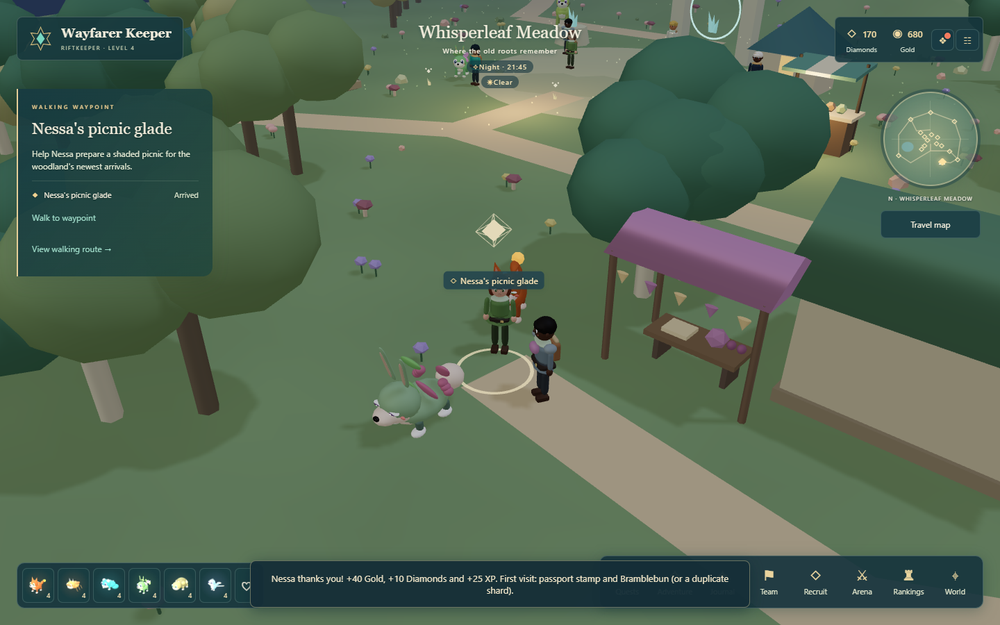
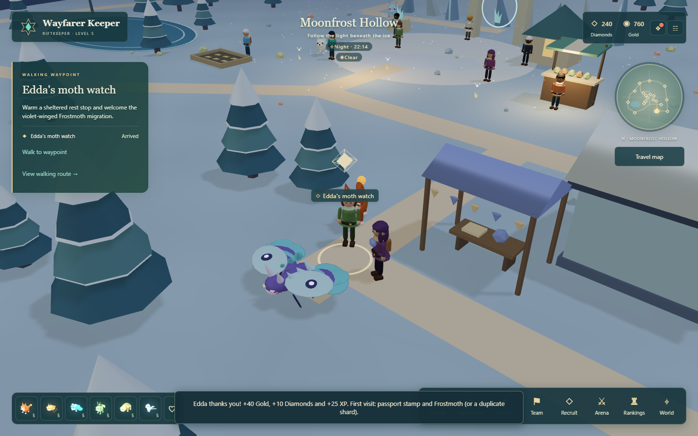
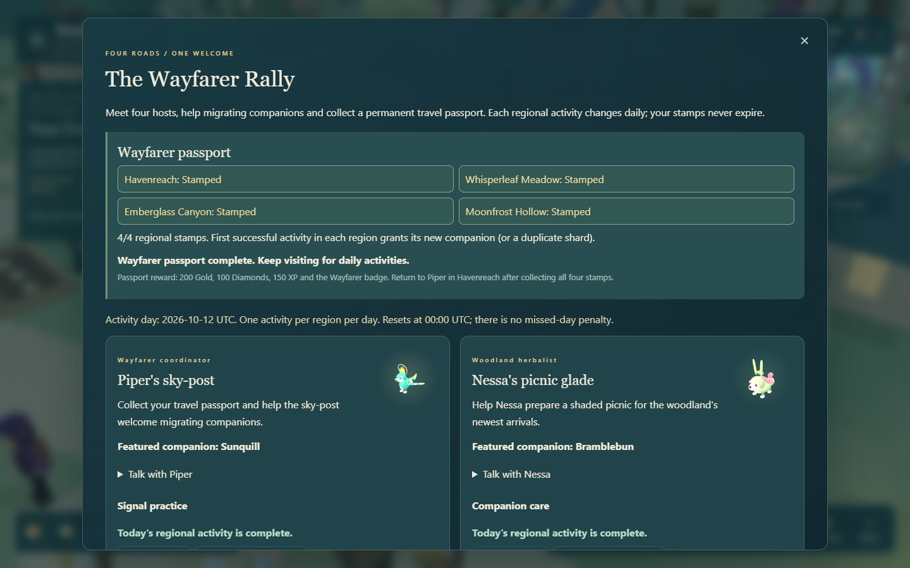

# The Wayfarer Rally

Four roads, one welcome. Meet travelling hosts across the four main regions, help migrating companions and fill a permanent passport. Open **Adventure > The Wayfarer Rally / Daily regional activities**, use **Events**, or select a host on the regional **Travel map** and choose **Set walking waypoint**, then **Walk to waypoint**.

Form your starting team of six with Warden Liora first. Whisperleaf is open immediately; Emberglass requires two wins and Moonfrost requires five. The rally does not require completing the four regional restoration journeys.

## Four stops and companions

| Region | Host and stop | First successful activity grants | Combat identity |
| --- | --- | --- | --- |
| Havenreach | Piper's sky-post | Sunquill | Light support bird; turquoise feathers, gold crest and shielding sun rings |
| Whisperleaf Meadow | Nessa's picnic glade | Bramblebun | Grove healer; leafy ears, rose berries, healing and regeneration |
| Emberglass Canyon | Orrin's cooling camp | Kilnback | Flame tank; charcoal shell, copper plates, guarding and reflection |
| Moonfrost Hollow | Edda's moth watch | Frostmoth | Frost controller; violet body, broad ice wings, slowing and marking |

All four are B-tier companions with three actions and a passive, available through the normal recruitment pool as well as the rally. They support the existing training, equipment, friendship and shimmer systems. A first visit grants a shard if you already own that species. It does not reroll an existing companion's appearance.

Each camp has a colored canopy, a host with a short story, regional props and an ambient featured companion. Its walking destination, map marker and approach trail share the same coordinates. **Talk with** the host to read their story.

## Today's activity

Each stop rotates between three activities, with one successful activity per region per UTC day:

- **Companion care:** select an owned companion of the requested element. Your initial six cover all requests: Storm for Piper, Grove for Nessa, Tide for Orrin and Flame for Edda. Helping grants up to five friendship, capped at 100.
- **Trail survey:** read the host's habitat clue and choose the matching answer.
- **Signal practice:** select Sun, Leaf and Star in the displayed order. Written labels and selected-note text make sound unnecessary; there is no timer. Clear the sequence to try again.

Every successful daily activity awards **40 Gold, 10 Diamonds and 25 XP**. Wrong answers spend nothing. Old-day submissions are rejected so an open panel cannot claim yesterday's activity. The journal refreshes its daily schedule while open; reopen it if your system clock changed.

Activities reset at **00:00 UTC**, with no missed-day penalty. The three activity types repeat on a three-day rotation. You may visit hosts in any order and complete your passport over multiple days.

## Complete the passport

Your first successful activity in each region permanently stamps the passport and grants its featured companion. After collecting all four stamps, return to Piper in Havenreach and select **Complete passport with Piper** for **200 Gold, 100 Diamonds, 150 XP and the Wayfarer badge**.

Stamps, companions, the completed passport and today's finished activities survive reloads. Daily rewards can be earned again after the next reset; first-visit companions and the passport reward cannot. Draft answers are temporary. This is a local saved activity, not a shared multiplayer event.

## Implementation and checks

- `packages/shared/rally.ts`: host definitions, activity rotation, passport state, camp collision and approach paths.
- `apps/server/rally-game.ts`: authoritative activity validation, rewards and passport completion.
- `apps/client/src/RallyCamp.tsx` and `RallyPanel.tsx`: regional scenery, hosts and journal.
- `tests/rally.test.ts`, `tests/rally-server.test.ts` and `tests/browser/rally.spec.ts`: route, daily rollover, reward validation, playable journey and camp graphics cleanup coverage.

See [PROGRESS.md](../PROGRESS.md) for the current verification results and [KNOWN_ISSUES.md](../KNOWN_ISSUES.md) for scope limits.
