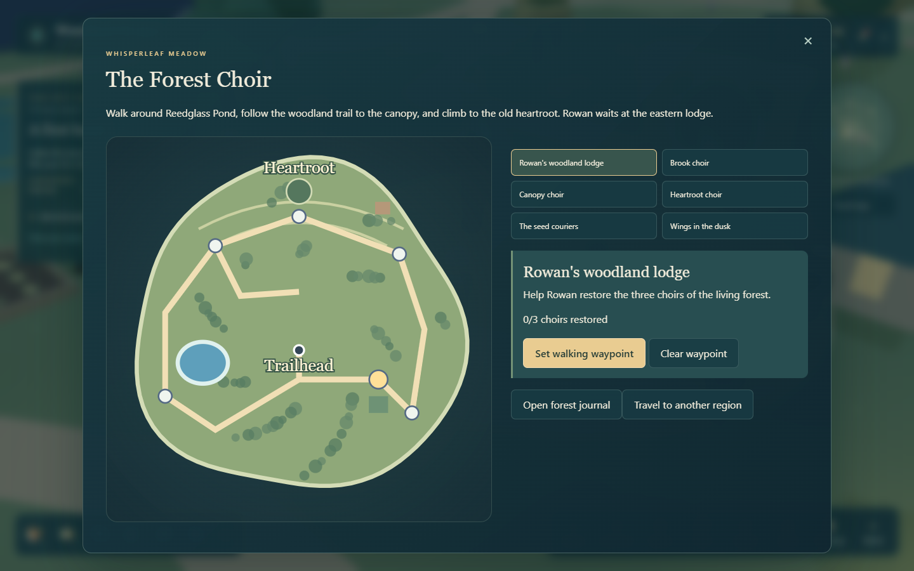
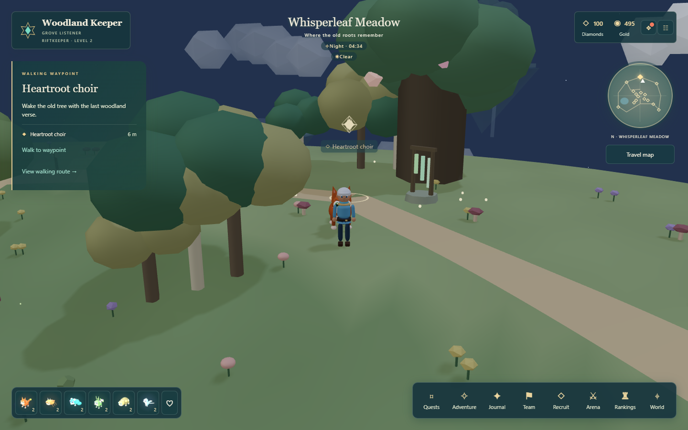

# Exploring Whisperleaf Meadow

Form your team of six, then choose **Travel map > Travel to another region > Whisperleaf Meadow**. No battle victories are required. Open **Adventure > The Forest Choir** for the full journal.



## The Forest Choir

1. Select **Rowan's woodland lodge** on the region map. Set a walking waypoint, walk to it, and begin the forest journey.
2. Visit **Brook choir**, **Canopy choir**, and **Heartroot choir** in any order. Each has a short verse containing the words Root, Rain, and Wing. Select the chimes in the order those words appear, then choose **Answer the choir**.
3. Wrong answers cost nothing. Use **Undo last chime** or **Clear melody** to change an answer. **Replay selected melody** plays it again. A written hint is available, and every puzzle works with audio muted; there is no timer or hearing requirement.
4. Each choir grants 35 Gold once. Its chimes glow when restored.
5. Return to Rowan after all three. Receive Fernibble (or a duplicate shard), 150 Gold, 50 Diamonds, 100 XP and the **Grove Listener** badge. The heartroot flowers and gentle lights appear around its clearing.

Completed choirs, notes and rewards survive reload. Unsubmitted melody selections are temporary and can be re-entered without cost. Duplicate reward requests are rejected or replayed safely by the server.

## Woodland discoveries

Reedglass Pond has lily pads and shore trails. The water blocks walking. The northern trail climbs three metres to the heartroot, with a second cottage near the canopy. Buildings are exterior landmarks.

Six ambient residents use five existing species: Fernibble, Mossprig, Bubbloom, Glimlet and Sylvarion. They follow terrain and collision rules, rest at night and open observation cards when clicked. This update adds habitats without changing the collectible roster or combat rules.

After meeting Rowan, visit **The seed couriers** and **Wings in the dusk** to record optional field notes. Each grants 20 Gold once. These notes are not required to complete the choirs.



## Controls and comfort

The region map and journal can track any of the six destinations. **Walk to waypoint** follows shared collision-aware routes; keyboard steering cancels it. The pause menu includes **Return to Whisperleaf trailhead**, **The Forest Choir journal**, and camera reset.

At the heartroot, step back and tilt the camera toward the horizon to view its flowering crown. Reduced motion stops the new decorative light movement. Sound effects and global mute control chime playback. Puzzle controls have written labels, shapes, selected-note text, and no time limit.

## Verification

```powershell
npx vitest run tests/meadow.test.ts tests/meadow-server.test.ts
npx playwright test tests/browser/meadow.spec.ts
```

See [PROGRESS.md](../PROGRESS.md) for current verification and [KNOWN_ISSUES.md](../KNOWN_ISSUES.md) for game limits.
